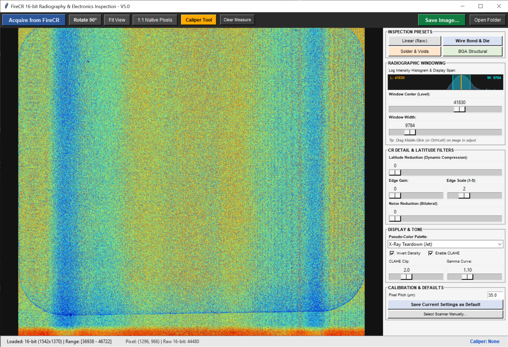

# FireCR 16-bit Radiography & Inspection

A lightweight, high-dynamic-range acquisition and analysis desktop application tailored for **FireCR Dental** computed radiography (CR) scanners. Designed primarily for non-destructive testing (NDT), electronics inspection, reverse engineering, and radiography analysis using reusable photostimulable phosphor (PSP) imaging plates.



---

## Overview

Most legacy and clinical software packages bundled with dental computed radiography hardware constrain image data to 8-bit displays, lock scans into closed medical databases, or apply proprietary tone curves. 

This application connects directly to the 32-bit TWAIN data source (`FireCRDentTwain32.ds`), pulls uncompressed **16-bit linear raw sensor data** directly from memory buffers, and provides real-time image processing, pseudo-coloring, adaptive local contrast enhancement, and calibrated metric measurement tools.

---

## Key Features

* **True 16-bit Ingestion:** Extracts uncompressed 16-bit grayscale bitmaps from native TWAIN DIB memory structures, preserving the full dynamic range of the scanner's photomultiplier tube (PMT).
* **Pseudo-Color False-Color Palettes:** Real-time OpenCV color mapping to highlight subtle density variations across silicon dies, bond wires, PCB traces, and solder joints:
  * *X-Ray Teardown (Jet)*
  * *Turbo (Perceptually Uniform)*
  * *Inferno (Thermal Density)*
  * *Ocean (Clinical Blue)*
  * *Hot (Black to Red/Yellow)*
  * *Monochrome (Raw Grayscale)*
* **CLAHE (Contrast-Limited Adaptive Histogram Equalization):** Localized histogram equalization to expose low-contrast trace routing and internal wire bonds obscured by dense metal shields or ground planes.
* **Non-Destructive Adjustments:** Real-time 65,536-level lookup table (LUT) processing for window leveling (brightness), contrast scaling, gamma curves, edge sharpening (unsharp mask), and density inversion.
* **Calibrated Digital Caliper:** Measure physical component dimensions, trace pitches, and clearances directly in millimeters, mils (thousandths of an inch), or raw pixels based on configurable scanner pixel pitch (e.g., 35 µm).
* **Hardware-Accelerated Viewport:** Fast fractional and integer zoom (up to 15×), mouse-centered zooming, panning, and native 1:1 pixel inspection.
* **Archival Export:** Save processed views as PNG or full 16-bit high-dynamic-range TIFF files named with ISO 8601 chronological timestamps (`Scan_YYYYMMDD_HHMMSS.tif`).

---

## System Requirements & Architecture

Because computed radiography drivers for the FireCR series (and most legacy dental hardware) are compiled strictly as **32-bit (x86) binaries**, this software **must run under a 32-bit Python environment**. A 64-bit Python runtime cannot bind to 32-bit TWAIN Data Source Managers (`twain_32.dll`).

* **Operating System:** Windows 10 / 11 (64-bit host OS is supported, running 32-bit Python).
* **Hardware:** 3DISC / Digiray / Quantor FireCR Dental reader.
* **Drivers:** FireCR Dental TWAIN Driver installed (`C:\Windows\twain_32\FireCRDental\FireCRDentTwain32.ds`).
* **Python Runtime:** Python 3.10 – 3.13 **(32-bit / x86 version)**.

---

## Installation

### 1. Install 32-bit Python
Download and install the **Windows installer (32-bit)** from [python.org](https://www.python.org/downloads/windows/). Ensure you check **"Add python.exe to PATH"** during setup.

Verify that your 32-bit interpreter is accessible:
```cmd
py -3-32 --version
```

### 2. Clone the Repository
```cmd
git clone https://github.com/your-username/firecr-radiography.git
cd firecr-radiography
```

### 3. Install Dependencies
Install the required packages in your 32-bit Python environment:
```cmd
py -3-32 -m pip install -r requirements.txt
```

If installing manually:
```cmd
py -3-32 -m pip install numpy opencv-python pillow pytwain
```

---

## Usage

Launch the application:
```cmd
py -3-32 firecr_capture.py
```

### Workflow

1. **Acquire:** Click **Acquire from FireCR** on the top toolbar. The native modal scanner interface will appear.
2. **Scan:** Insert your photostimulable phosphor plate (Size 0, 1, 2, 3, or 4c) into the scanner feeder slot.
3. **Inspect:** Once the scan finishes, the 16-bit image transfers directly into the canvas.
4. **Enhance:**
   * Toggle **CLAHE** to pull traces and bond wires out of dark shadow regions.
   * Switch the **Pseudo-Color Palette** to *X-Ray Teardown (Jet)* or *Turbo* to visualize density gradations.
   * Fine-tune **Brightness**, **Contrast**, and **Gamma**.
5. **Measure:**
   * Toggle the **Caliper Tool** on the toolbar (or right-click and drag on the image).
   * Enter the exact optical scanner pixel pitch (default is `35.0` µm for high-resolution dental CR plates).
   * Readouts display distance in **mm**, **mil**, and **px**.
6. **Save:** Click **Save Image...** to export a 16-bit `.tif` or `.png`. Use **Open Folder** to view recent scans in Windows Explorer.

---

## Configuration (`settings.txt`)

User preferences (color palettes, slider positions, pixel pitch, and last used directories) persist automatically across sessions in a JSON-formatted `settings.txt` created in the application root directory:

```json
{
    "twain_source": "FireCR Dental",
    "palette": "X-Ray Teardown (Jet)",
    "brightness": 0.0,
    "contrast": 1.2,
    "gamma": 1.1,
    "sharpness": 1.0,
    "clahe_enabled": true,
    "clahe_clip": 2.0,
    "invert": true,
    "pixel_pitch_um": 35.0,
    "last_saved_dir": "C:\\Scans"
}
```

Click **Save Settings as Default** in the control panel to lock in your preferred initial calibration and display values.

---

## Viewport Controls

| Input | Action |
| :--- | :--- |
| **Left Click + Drag** | Pan image across canvas (when Caliper is off) |
| **Mouse Wheel** | Zoom in / Zoom out centered on cursor |
| **Right Click + Drag** | Draw quick caliper measurement line |
| **Fit View Button** | Scale image to fit viewport |
| **1:1 Native Pixels Button** | View full unscaled sensor resolution |
| **Rotate 90° Button** | Rotate sensor array 90 degrees clockwise |

---

## Technical Notes

* **Direct BMP Memory Parsing:** Rather than relying on standard GDI/Pillow decoders that truncate 16-bit grayscale bitmaps to 8 bits, the program unpacks the raw TWAIN DIB memory buffer using custom 16-bit row stride alignment:
  $$\text{Row Stride} = \left\lfloor \frac{\text{Width} \times 2 + 3}{4} \right\rfloor \times 4$$
* **Percentile Dynamic Range Normalization:** Images are auto-leveled based on the 0.1th and 99.9th percentiles of raw intensity, avoiding saturation from single dead/hot detector pixels.

---

## License

Distributed under the MIT License. See `LICENSE` for more information.